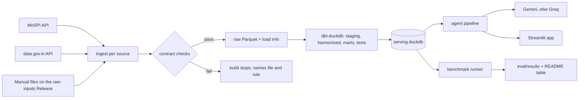

# India Public Data Agent: design

Status: agreed scope, 26 Oct 2026, updated after the source data check the same day.

## 1. What it is

An AI analyst for India's public state-level data. A user asks a plain-English question
("Which states grew UPI usage fastest, and does it track literacy?") and gets:

- a short answer and a chart,
- the exact SQL that ran and a paged result table,
- the sources with release and download dates,
- caveats (correlation is not causation, missing coverage, old Census figures),
- or "I don't know", with the reason, when the data can't answer.

What makes it different from a plain "LLM over MoSPI" tool:

1. A harmonised warehouse: state names, codes, periods and units aligned across sources.
2. A metrics layer: the agent uses defined metrics and combining rules, not invented formulas.
3. A public benchmark: 155 questions with known answers, comparing the agent with a plain LLM
   and with an agent that has no metrics layer, including error analysis and negative results.
4. Guardrails enforced by code, not by the LLM's goodwill.

Hard constraints: ₹0 cost (free-tier LLM APIs only); Python runs only on GitHub Actions;
raw data stays out of git.

## 2. First 10 datasets

| # | Dataset | Source | Access |
|---|---|---|---|
| 1 | UPI volume and value by state, monthly | NPCI | Manual download |
| 2 | GSDP and NSDP per capita, current and constant prices | RBI Handbook 2024-25, Tables 19–24 | Manual Excel |
| 3 | Population (projections, 1 July, 2011–2036) and literacy (Census 2011) | National Commission on Population; Census of India | Manual PDF / Excel |
| 4 | Bank deposits, credit and branches (SCB) | RBI Handbook 2024-25, Tables 152, 155, 156 | Manual Excel |
| 5 | CPI rural, urban and combined, monthly, Jan 2013–Dec 2025 (base 2012) | MoSPI API | API (token, 15 min) |
| 6 | PLFS UR, LFPR, WPR: July–June 2017-18 to 2023-24 and calendar 2022–2025 | MoSPI API | API (token) |
| 7 | ASI factories, output, GVA, persons engaged, 2008-09 to 2023-24 | MoSPI API | API (token) |
| 8 | NFHS-5 (API) and NFHS-4 (CSV) state indicators | data.gov.in | API (key) + manual |
| 9 | Telecom subscribers by service area | TRAI monthly reports | Manual PDF |
| 10 | GST collections by state, monthly, 2017-18 onwards | GST statistics page | Scripted download |

Exact endpoints, files and fields: [data-sources.md](data-sources.md) (checked 26 Oct 2026).

Decisions from the data check:
- Sources are matched to LGD **by state name**; source-specific codes (MoSPI uses three systems) are never joined on.
- CPI stops at December 2025 because the 2024-base series is not in the API; the two series are not spliced.
- PLFS July–June and calendar-year figures are separate period types and never mixed in one series.
- The UPI unclassified share is taken from each month's NPCI file, not a fixed figure.
- MetricFlow (Apache-2.0, `dbt-metricflow[dbt-duckdb]`) is used for metric definitions at build time.

## 3. Architecture



- **Manual files** (RBI, NPCI, TRAI, GSTN) are uploaded through the GitHub website as assets on
  a Release named `raw-inputs`. `data/manifest.yml` (in git) records each file's name, original
  URL, download date and SHA-256. Workflows download the assets and check the hashes.
- **Full rebuilds**: each refresh pulls full history (the sources are small aggregates).
  A `revisions` table records values that changed since the last serving file.
- **One state list**: `dim_state` keyed on LGD codes, with name variants and validity dates
  (Telangana 2014, J&K and Ladakh 2019, Dadra and Nagar Haveli and Daman and Diu 2020).
  Unmatched names fail the build.

Repo layout:

```
src/bharat/
  reference/   state list and name matching
  contracts/   contract checker + one YAML per source
  ingest/      one module per source
  agent/       plan, sql_guard, coverage, answer, number_check, caveats, charts, llm
  app/         Streamlit pages
dbt/           staging -> harmonised -> marts, tests, metrics YAML
eval/          questions, gold SQL, scorer, runner, results, error analysis
tests/         pytest (fake LLM, no quota used)
.github/workflows/  ci.yml, refresh.yml, benchmark.yml
```

## 4. Data layer

**Contracts** (YAML per source, checked before dbt): columns and types, key, non-null columns,
value ranges, state names must resolve, row count within ±20% of last build, freshness.

**Periods**: each metric keeps its native grain (month, FY, survey year July–June, survey round).
`dim_period` lists labels and start/end dates. Monthly to FY only by a declared rule
(sum for flows such as UPI and GST, mean for indices such as CPI). PLFS survey year vs FY
gets a caveat. Snapshots (Census 2011, NFHS rounds) carry their real year.

**Units**: money in ₹ crore (displayed as crore or lakh crore), people as counts, shares in %,
indices with base year, GSDP flagged current or constant prices with base year.

**dbt layers**: `staging` (rename, cast, keep original state name) -> `harmonised`
(join to states and periods, convert units, long format) -> `marts`:
`fct_state_metric`, `fct_national_metric`, `dim_state`, `dim_period`, `dim_metric`,
`dim_source`, `revisions`, `coverage` (which metric x state x period exists).

**Tests**: not-null, unique keys, relationships, metric value ranges, state totals vs national
within tolerance; for UPI the expected gap must be disclosed rather than closed.

**Metrics**: defined once in YAML: id, description, formula (base or ratio), unit, grain,
source, caveats and a **state combining rule** (sum allowed, or must recompute from parts).
Growth (YoY, CAGR, percentage-point change) is a shared function, not a metric per case.
Metrics are written in MetricFlow's semantic-layer YAML and validated in CI; the app reads the
compiled metric list and the tidy table, so it does not need MetricFlow at run time.
Per-person metrics use the official population projections (1 July of each year).

## 5. Agent (fixed-step pipeline)

The LLM does language work. Code does everything that must be right. About 3 LLM calls a question.

| Step | Who | What |
|---|---|---|
| 0 Cache | code | Same question + same data version returns the saved answer |
| 1 Plan | LLM | JSON: answerable yes/no/unclear, interpretation, metrics, states, periods, task type. Unknown metric IDs rejected |
| 2 Coverage | code | Refuse with what *is* available, or answer partially and say so. Catches states that did not exist and circle-only data |
| 3 SQL | LLM | Plan + mart schemas + worked examples from the **dev set only** |
| 4 SQL guard | code | sqlglot: one SELECT, allowed tables only, no file/ATTACH/COPY functions, row cap; DuckDB read-only with external access off; result non-empty; metrics match plan; no averaging of non-additive metrics. Up to 2 repair retries, then "I couldn't answer reliably" |
| 5 Maths | code | Correlation (Pearson and Spearman, with n) and growth figures |
| 6 Answer | LLM | ~80 words using only the result table |
| 7 Number check | code | Every number in the answer must appear in the results (rounding allowed); one retry, then a template answer |
| 8 Caveats | code | Rule-based: correlation, UPI unattributed share, Census 2011, PLFS vs FY, revisions, small n |
| 9 Chart | code | Bar (ranking), line (trend), scatter with r and n (relationship), via Altair |

LLM client: one OpenAI-compatible client for Gemini and Groq (both endpoints confirmed),
temperature 0, fixed model per provider, fallback on rate limit/error/timeout, fallback logged.
Questions are untrusted input; steps 2, 4 and 7 are code and cannot be argued with.

## 6. Benchmark

- 155 questions in 11 types: single fact 20, ranking 15, change over time 20, scaled comparison 15,
  combining sources 15, trend 10, groups of states 10, matching traps 15, can't be answered 20,
  cause-and-effect traps 10, unclear 5.
- Each question: id, type, split, text, expected behaviour (answer, refuse, caveat, clarify),
  gold values from reference SQL, tolerance, required caveats, sources.
- Gold answers are computed against a pinned serving file (by hash). After a refresh, gold SQL
  is re-run and differences are listed for review.
- Questions are drafted from the coverage table, reviewed and edited by the author, and at least
  20% of gold answers are checked by hand against source files. Questions are committed before
  any agent code.
- Split: 55 test (stratified by type, separate file), ~100 dev. Test runs only at milestones;
  the report states how many test runs there were.
- Setups (same model): plain LLM; agent without metrics layer (harmonised tables, no metric
  definitions, no coverage gate, no caveat rules, but with SQL guard and number check);
  full agent. Optional: agent on uncleaned tables.
- All setups output the same structured block (status, values, caveats); a Python scorer marks
  numbers by tolerance, rankings by strict order, trends by 95% of points, refusals by status.
  Free-text caveats are keyword-matched (a stated limitation, hand-audited on a sample).
- Report: accuracy overall and by type with 95% Wilson intervals, wrong-answer rate, over-refusal
  rate, LLM calls, latency, fallbacks, and failures labelled by pipeline step in
  `eval/error_analysis.md`.
- `benchmark.yml` is a click-to-run workflow with response caching and resume.

## 7. App

Streamlit + Altair, deployed on Streamlit Community Cloud (about 1 GB RAM, so no local LLM).

- Pages in the sidebar: **Ask**, **Benchmark results**, **Data sources and coverage**, **Method and limits**.
- Look: one brand colour (deep blue `#1D4E89`), white cards on a soft grey background (`#F5F7FA`),
  clean sans-serif type, no glows, minimal emoji, plain language.
- Under every answer: SQL, sources with dates, caveats, "How this was answered" trace.
- Long tables paginated; no truncated text; checked at 1366 px width.
- API keys in Streamlit secrets; a small set of example questions on the Ask page.

## 8. Workflows and testing

- `ci.yml` (every push): uv sync, ruff check and format check, pytest, and later dbt build and
  tests on small fixture data. No LLM calls (fake LLM with recorded responses).
- `refresh.yml` (monthly schedule + manual): ingest, contracts, dbt build and tests, revisions,
  commit the small serving file.
- `benchmark.yml` (manual): runs chosen setups on dev or test, commits results and report.

## 9. Build phases (one or more commits each)

1. Foundation: repo, CI, state list, contract checker, SQL guard, number check.
2. Ingest: MoSPI (CPI, PLFS, ASI), data.gov.in (NFHS), manual-file loader with manifest.
3. Warehouse: dbt models, tests, metrics YAML, coverage, revisions, serving file.
4. Benchmark: questions frozen (dev/test), gold SQL, scorer, CI test of the scorer.
5. Agent: LLM client, plan, coverage gate, SQL, answer, caveats, charts, fake-LLM tests.
6. Evaluation: three-setup runs, error analysis.
7. App: Streamlit pages and deployment.
8. README with results, screenshot and architecture.

## 10. Known limits (so far)

- A large, month-varying share of UPI volume has no state (about 27.5% for FY2024-25 per Dataful; 41.7% in June 2025 per Business Standard), so state totals do not add up to the national figure.
- CPI by state ends December 2025 in the MoSPI API.
- RBI and NPCI block scripted downloads, so those refreshes depend on a manual step.
- Census 2011 is old; literacy and population questions say so.
- TRAI reports by service area, not state; state-level answers are refused where circles span states.
- 55 test questions give wide confidence intervals; results are reported with them.
